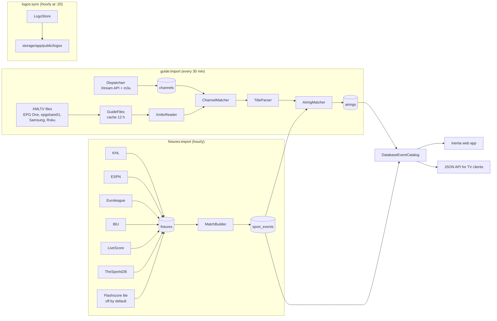
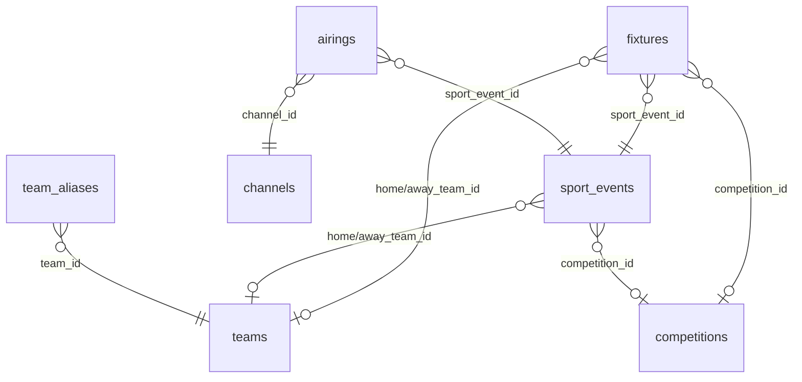

# Architecture

Sports is an events-first front end for a homelab IPTV server. Instead of
browsing hundreds of channels, the user browses matches; each match lists the
channels that show it (live, simulcast or replay) and plays the stream in the
browser.

**Core rule: the schedule is the source of truth.** Matches come from sports
APIs. TV guides never create events — they only attach broadcasts to matches
that already exist. A guide programme that matches nothing is ignored, and a
match without any broadcast is hidden.

## Data flow

## Stage 1 — schedule (`app/Guide/Fixtures`, `app/Guide/Matches/MatchBuilder.php`)

- `FixtureImporter` asks every enabled `FixtureSource` for days `-days_back..+days_ahead`
  (default today..+6; TheSportsDB only today..+1 because the free key is rate-limited).
  A failing source or day is logged and skipped; the command fails only if
  nothing loaded at all.
- Each fixture gets teams (`TeamRegistry`, national teams via `NationalTeams`)
  and a competition (`CompetitionRegistry` / `CompetitionCatalog`).
- `MatchBuilder` merges fixtures of the same match from several sources into
  one `sport_events` row: same sport, kick-off within ±15 minutes, same teams
  (same team ids or `TeamMatch` score ≥ 1.5, not swapped). The best source
  wins for time, names, competition and score:
  **KHL > Euroleague = IBU > ESPN > TheSportsDB > LiveScore > Flashscore**.
  Match ids are stable across runs; a future match that vanished from every
  source is deleted; history older than 14 days is pruned.
- **Events without opponents** (an F1 session, a biathlon race) have no
  `home`/`away` and carry `fixtures.title` instead (`Gulf Air Bahrain Grand
  Prix`, `Спринт · Мужчины`). They are never merged with anything.
- Individual sports map onto home/away: a tennis match is two players; a UFC
  card is **one** event whose sides are the main-event fighters and whose start
  is the main card (that is how guides name and air it).

| Source              | Sports                                                     | Notes                                                               |
| ------------------- | ---------------------------------------------------------- | ------------------------------------------------------------------- |
| `KhlSource`         | KHL                                                        | mobile API, Russian names, logos                                    |
| `EspnSource`        | football (RPL, top-5, UEFA cups, Nations League), NHL, NBA; ATP/WTA singles, UFC cards, F1 sessions | unofficial, keyless; competition logos; tennis payload is a whole tournament, filtered by day |
| `EuroleagueSource`  | Euroleague, EuroCup                                        | whole season in one request                                         |
| `IbuSource`         | biathlon: World Cup, World Championships                   | official open results API; season and stage lists cached per run    |
| `LiveScoreSource`   | hundreds of football, hockey, basketball leagues           | unofficial, personal use; ids are `sport:Eid`                       |
| `TheSportsDbSource` | volleyball, handball, rugby                                | free key `123`: 3 matches per sport per day, ~3 requests per minute |
| `FlashscoreSource`  | handball, volleyball, rugby, futsal, bandy, water polo     | lite HTML, **off by default** (site terms); Prague time; partial failures are warnings (`ReportsDiagnostics`) |

`FlashscoreSource` (handball, volleyball, rugby, futsal, bandy, water polo) is
**disabled by default**. It reads the public lite HTML of www.flashscore.mobi:
plain pages, no login or signed requests. A challenge or unexpected page
fails the day; it is never worked around. The site's terms restrict scraping,
so enabling it is the owner's call. It has the lowest merge priority. The
Flashscore desktop site (signed feed) and Championat (`/stat/` is behind a
SberID JS check) are not used. Details: `docs/operations.md`.

## Stage 2 — TV guides (`app/Guide/Listings`)

Dispatcharr supplies only channels (Xtream `player_api.php`), their `tvg-id`
(open playlist `/output/m3u?tvg_id_source=tvg_id`) and stream URLs. **Its own
XMLTV is not used.**

1. **Channels** — `GuideImporter::importChannels()` upserts `channels` by
   `stream_id`. A `tvg-id` equal to the channel number is a Dispatcharr
   placeholder and is dropped.
2. **Guide files** — `GuideFiles` downloads each `sports.guides.sources` entry
   into `storage/app/private/guides/{key}` at most every `refresh_hours`
   (cache flag), validates it is XMLTV (gzip or plain), and falls back to the
   previous file on failure (reported as a warning).
3. **Channel ↔ guide** — `ChannelMatcher`:
    - exact `tvg-id` (`Sport1.cz@SD` → `Sport1.cz`; EPG One uses numbers like `2003`);
    - otherwise name key (lowercase, no spaces, no HD/SD/TV noise, no trailing
      country code: `Teledeporte HD ES` = `Teledeporte`) **within the same country**.
      Countries come from the `tvg-id` suffix and, on the guide side, from the id
      suffix or a country code at the end of display names (`SPORT 4 HD IL`).
      A guide channel with no known country can match anything; `any_country`
      sources (FAST services) too;
    - a language feed (`FIFAPlus.uk@Spain`) is never matched through the base id;
    - name matches need a real schedule in the next 48 h (≥ 4 programmes,
      ≥ 2 distinct titles) — one title all day is a placeholder;
    - ranking: exact id > same country > more distinct titles > more programmes > source order;
    - manual overrides: `sports.guides.channels` (`'Name' => 'source:id'` or `null`).
      The choice is saved in `channels.guide_source` / `guide_channel`.
4. **Programmes** — `XmltvReader` streams only the candidate channels'
   programmes in `[now-1d, now+days_ahead]` (EPG One: 700k programmes in ~3 s).
5. **Parsing** — `TitleParser` turns a title into `ParsedTitle` (sport,
   competition, home/away, round, live/replay flags). If the title holds only
   the sport (`Lední hokej`, `WNBA Basketball`), `GuideImporter` retries with
   `title + ". " + sub-title` and then `+ description` (`Programme::details()`:
   parentheses unwrapped, credit lines dropped, ≤ 200 chars).
   Supported: Russian, English, Czech, Slovak, Hungarian, Romanian, Serbian,
   Spanish, French, Italian (sport words, stages, live/replay markers, genders),
   pairs written with `–`, `vs`, `v`, `at` (home team second) and `A / B`.
   Shows, studios, highlights, magazines and sports we don't cover (American
   football, baseball, cricket) return `null`.
6. **Matching** — `AiringMatcher`:
    - with teams: same sport and category (`TeamCategory`: U21, women), both
      teams similar (`TeamMatch` / `NameSimilarity`: transliteration, phonetic
      key, exonyms, countries in ~15 languages, 2-letter abbreviations, short
      names only exact so `СКА` ≠ `ЦСКА`); live if the programme starts within
      ±45 min of kick-off (score ≥ 1.0), replay if later within 14 days (score ≥ 1.5);
    - without teams (`Чемпионат КХЛ`, `UFC 333`, `Формула-1. Гран-при
      Бахрейна. Гонка`): the single event of that catalog competition starting
      −15/+45 min from the slot — any event for team sports and UFC
      (`SportRegistry::isOneEventPerSlot`), otherwise only events without
      opponents. A tennis tournament slot (`ATP1000: Shanghai Masters`) covers
      many matches and attaches to none. A Russian slot title renames a
      Latin-titled race (`Гран-при Сингапура`);
    - full matches (score 2.0) teach Russian spellings (`TeamRegistry::learn`)
      and rename a Latin-named match to the Russian guide title.
7. `airings` from the guide window start onwards are rebuilt in one transaction;
   older airings stay as history.

## Stage 3 — logos (`app/Guide/Logos`)

`LogoStore` downloads team and competition logos, fits them into 256×256 and
stores WebP under `storage/app/public/logos` (served as `/storage/...`, needs
`storage:link`). Visible items first; a failed download is retried after 24 h.
Team logo priority: flag > KHL > Euroleague > ESPN > TheSportsDB > LiveScore.
National teams use flagcdn.com flags (rendered as a full circle).

## Read side

- `EventCatalog` (interface) — `DatabaseEventCatalog` (default; only matches
  with airings) or `FakeEventCatalog` (`SPORTS_SOURCE=fake`, deterministic
  generated week, used by tests).
- Data objects in `app/Guide/Data`: `Event`, `Broadcast`, `Team`, `Competition`,
  `Score`, `Sport`, `EventStatus` (`upcoming|live|finished`, computed from
  kick-off and per-sport duration).
- `HomeShelves` — featured, live now, starting soon, one shelf per sport
  (shared by web and API).
- `Channels` — channels with matches, what is on now, a channel's schedule.
- Broadcast order: `sports.preferred_languages`, then quality.
- Stream URLs contain the Xtream login, so they are only exposed to logged-in
  users on the watch page and the stream/channel API endpoints — never in lists.

## Database

| Table          | What                                                                                             |
| -------------- | ------------------------------------------------------------------------------------------------ |
| `fixtures`     | one row per source match (`source`, `external_id`, teams, score, status)                         |
| `sport_events` | canonical match (title, teams, competition, `starts_at`/`ends_at`, `search` text)                |
| `channels`     | Dispatcharr channel (`stream_id`, `number`, `tvg_id`, `guide_source`, `guide_channel`, language) |
| `airings`      | a broadcast of a match on a channel (`live` / `replay`, guide title, times)                      |
| `teams`        | one team for all spellings; logo url/source/path                                                 |
| `team_aliases` | normalized spellings per source (`guide` = learned from TV guides)                               |
| `competitions` | curated catalog entries + logos                                                                  |

## Frontend

Inertia 3 + React 19 + TypeScript, Tailwind 4, shadcn/ui. UI text is Russian.

- Pages (`resources/js/pages`): `home`, `schedule`, `sport`, `event`, `watch`,
  `channels`, `channel`, `search`, `settings/*`, `auth/*`.
- Layout `layouts/app-layout.tsx`: sidebar (sections, sports, channels with
  on-air dots) on desktop, 5-tab bar on mobile.
- `components/live-player.tsx` — mpegts.js with worker + stash buffer and no
  live-latency chasing (Dispatcharr delivers ~6 s bursts every ~7 s; chasing
  caused constant stalls).
- `components/broadcast-list.tsx` — `splitBroadcasts()`: playable (live or on
  air now) vs. future replays (shown as times only, not playable).
- Front end recomputes event status from the browser clock.

## Where to change what

| Task                               | Place                                                                                                           |
| ---------------------------------- | --------------------------------------------------------------------------------------------------------------- |
| New schedule source                | implement `FixtureSource`, register in `AppServiceProvider::fixtureSources()`, config `sports.fixtures.sources` |
| New guide file                     | `config/sports.php` → `guides.sources`                                                                          |
| Wrong channel ↔ guide link         | `guides.channels` override                                                                                      |
| Guide title not recognized         | `Listings/TitleParser` constants + dataset in `tests/Unit/TitleParserTest.php`                                  |
| New sport word / league keyword    | `Guide/SportRegistry`                                                                                           |
| Wrong team match                   | `Fixtures/NameSimilarity` (exonyms, generic words) + `tests/Feature/FixturesTest.php`                           |
| Competition names / logos / weight | `Competitions/CompetitionCatalog`                                                                               |
